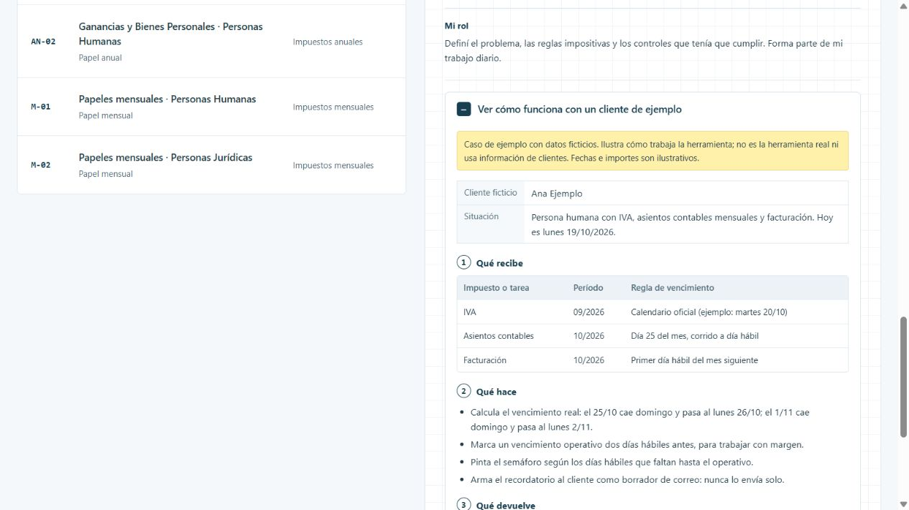

# Calendart

Seguir a mano los vencimientos de decenas de clientes es fácil de olvidar y difícil de repartir. Calendart arma el calendario de cada cliente y avisa con tiempo qué vence.

[Ver la ficha y el caso en el portfolio](https://martinisanchez7.github.io/#calendart/ejemplo) · [Volver al índice](../../README.md)

## Qué recibe

Cartera de clientes, impuestos de cada uno, calendarios oficiales de vencimientos y reuniones.

## Qué hace

Genera las obligaciones de cada mes con su vencimiento real, corridas por feriados y fines de semana. Marca un vencimiento operativo dos días hábiles antes, con semáforo. Sigue el estado de las DDJJ anuales con su checklist. Prepara recordatorios a clientes como borrador de correo, sin enviarlos solo. Avisa cuando dos reuniones se superponen.

## Qué devuelve

Tablero de vencimientos con semáforo, pendientes por persona, agenda y borradores de recordatorio.

## Estado y alcance

En uso. Corre en una computadora local. El acceso para todo el equipo está en desarrollo.

## Mi rol

Definí el problema, las reglas impositivas y los controles que tenía que cumplir. Forma parte de mi trabajo diario.

## Tecnologías

Next.js · TypeScript · React · Prisma · SQLite

## Caso de ejemplo

Caso de ejemplo con datos ficticios. Ilustra cómo trabaja la herramienta; no es la herramienta real ni usa información de clientes. Fechas e importes son ilustrativos.

**Ana Ejemplo.** Persona humana con IVA, asientos contables mensuales y facturación. Hoy es lunes 19/10/2026.

### Qué recibe

| Impuesto o tarea | Período | Regla de vencimiento |
| --- | --- | --- |
| IVA | 09/2026 | Calendario oficial (ejemplo: martes 20/10) |
| Asientos contables | 10/2026 | Día 25 del mes, corrido a día hábil |
| Facturación | 10/2026 | Primer día hábil del mes siguiente |

### Qué hace

- Calcula el vencimiento real: el 25/10 cae domingo y pasa al lunes 26/10; el 1/11 cae domingo y pasa al lunes 2/11.
- Marca un vencimiento operativo dos días hábiles antes, para trabajar con margen.
- Pinta el semáforo según los días hábiles que faltan hasta el operativo.
- Arma el recordatorio al cliente como borrador de correo: nunca lo envía solo.

### Qué devuelve

| Impuesto o tarea | Vencimiento | Operativo | Semáforo |
| --- | --- | --- | --- |
| IVA 09/2026 | mar 20/10 | vie 16/10 | Pasó el operativo |
| Asientos 10/2026 | lun 26/10 | jue 22/10 | Faltan 3 días hábiles |
| Facturación 10/2026 | lun 02/11 | jue 29/10 | En plazo |

El IVA pasó su vencimiento operativo, pero todavía está dentro del vencimiento real: el tablero lo muestra primero.

## Captura del caso

