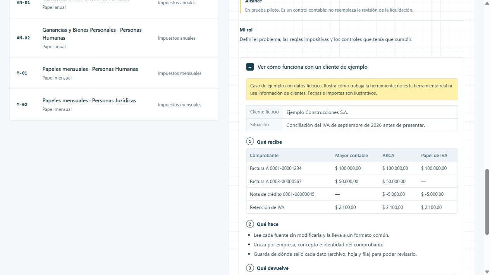

# ConcIVAbot

Antes de presentar el IVA hay que confirmar que lo contabilizado, lo que informa ARCA y lo que entra en la liquidación coincidan. Hacerlo a mano, comprobante por comprobante, es lento y se escapan diferencias.

[Ver la ficha y el caso en el portfolio](https://martinisanchez7.github.io/#concivabot/ejemplo) · [Volver al índice](../../README.md)

## Qué recibe

Mayores contables exportados del sistema de gestión, comprobantes y retenciones de ARCA, y el papel de IVA.

## Qué hace

Lee cada fuente sin modificarla y la lleva a un formato común. Cruza por empresa, concepto e identidad del comprobante, y muestra coincidencias y diferencias con su archivo, hoja y fila de origen. Guarda los pendientes de un mes para el siguiente.

## Qué devuelve

Diferencias para revisar, coincidencias con trazabilidad e historial de pendientes por mes.

## Estado y alcance

Piloto. En prueba piloto. Es un control contable: no reemplaza la revisión de la liquidación.

## Mi rol

Definí el problema, las reglas impositivas y los controles que tenía que cumplir.

## Tecnologías

JavaScript · Node.js · ExcelJS · SheetJS

## Caso de ejemplo

Caso de ejemplo con datos ficticios. Ilustra cómo trabaja la herramienta; no es la herramienta real ni usa información de clientes. Fechas e importes son ilustrativos.

**Ejemplo Construcciones S.A..** Conciliación del IVA de septiembre de 2026 antes de presentar.

### Qué recibe

| Comprobante | Mayor contable | ARCA | Papel de IVA |
| --- | --- | --- | --- |
| Factura A 0001-00001234 | $ 100.000,00 | $ 100.000,00 | $ 100.000,00 |
| Factura A 0003-00000567 | $ 50.000,00 | $ 50.000,00 | — |
| Nota de crédito 0001-00000045 | — | $ -5.000,00 | $ -5.000,00 |
| Retención de IVA | $ 2.100,00 | $ 2.100,00 | $ 2.100,00 |

### Qué hace

- Lee cada fuente sin modificarla y la lleva a un formato común.
- Cruza por empresa, concepto e identidad del comprobante.
- Guarda de dónde salió cada dato (archivo, hoja y fila) para poder revisarlo.

### Qué devuelve

| Comprobante | Resultado | Qué revisar |
| --- | --- | --- |
| Factura A 0001-00001234 | Coincide en las tres fuentes | — |
| Factura A 0003-00000567 | Falta en el papel de IVA | Incorporarla a la liquidación |
| Nota de crédito 0001-00000045 | Falta contabilizar | Pedir el asiento a contabilidad |
| Retención de IVA | Coincide en las tres fuentes | — |

Las diferencias que no se resuelven en el mes quedan como pendientes para el mes siguiente.

## Captura del caso

