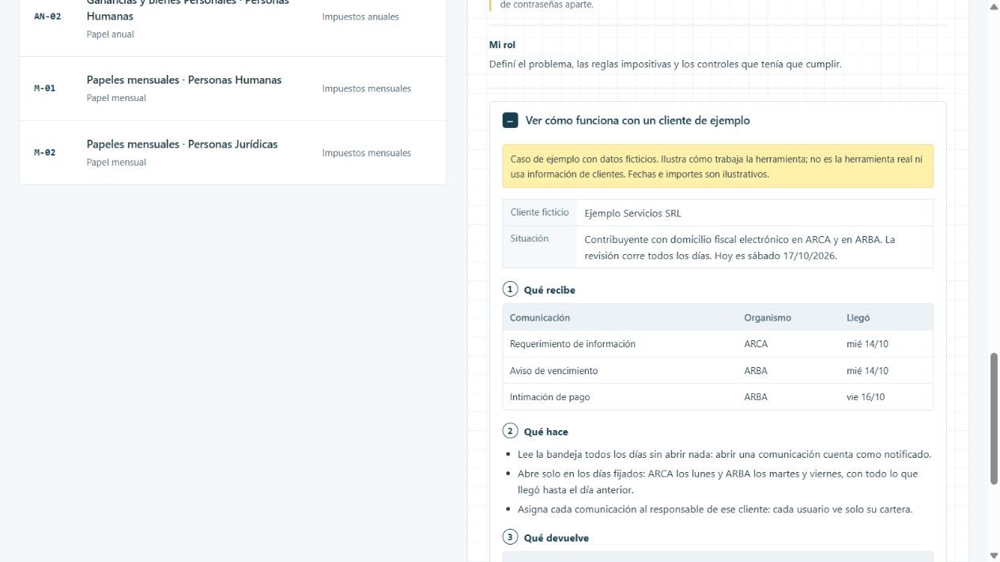

# DFE-AUTO

Revisar una por una las notificaciones de ARCA y ARBA de cada contribuyente lleva tiempo, y abrir una comunicación tiene efectos legales. DFE-AUTO revisa todo con un calendario fijo y reparte lo que llega a quien corresponde.

[Ver la ficha y el caso en el portfolio](https://martinisanchez7.github.io/#dfe-auto/ejemplo) · [Volver al índice](../../README.md)

## Qué recibe

Cartera de contribuyentes, responsables asignados y calendario de revisión por organismo.

## Qué hace

Lee las comunicaciones todos los días sin abrirlas. Las abre solo los días fijados para cada organismo, porque abrir una notificación cuenta como notificado. Está pensado para ordenar las consultas por credencial y no por contribuyente, con muchos menos inicios de sesión. Cada usuario ve solo su cartera.

## Qué devuelve

Listado de comunicaciones con su documento, estado de atención y avisos para el responsable de cada cliente.

## Estado y alcance

En implementación. Funciona en una instalación local. Las claves fiscales nunca se guardan en la aplicación: quedan en un gestor de contraseñas aparte.

## Mi rol

Definí el problema, las reglas impositivas y los controles que tenía que cumplir.

## Tecnologías

Node.js · TypeScript · Fastify · Prisma · SQLite

## Caso de ejemplo

Caso de ejemplo con datos ficticios. Ilustra cómo trabaja la herramienta; no es la herramienta real ni usa información de clientes. Fechas e importes son ilustrativos.

**Ejemplo Servicios SRL.** Contribuyente con domicilio fiscal electrónico en ARCA y en ARBA. La revisión corre todos los días. Hoy es sábado 17/10/2026.

### Qué recibe

| Comunicación | Organismo | Llegó |
| --- | --- | --- |
| Requerimiento de información | ARCA | mié 14/10 |
| Aviso de vencimiento | ARBA | mié 14/10 |
| Intimación de pago | ARBA | vie 16/10 |

### Qué hace

- Lee la bandeja todos los días sin abrir nada: abrir una comunicación cuenta como notificado.
- Abre solo en los días fijados: ARCA los lunes y ARBA los martes y viernes, con todo lo que llegó hasta el día anterior.
- Asigna cada comunicación al responsable de ese cliente: cada usuario ve solo su cartera.

### Qué devuelve

| Comunicación | Organismo | Se abre | Responsable | Estado |
| --- | --- | --- | --- | --- |
| Requerimiento de información | ARCA | lun 19/10 | Responsable de la cartera A | Leída, sin abrir |
| Aviso de vencimiento | ARBA | vie 16/10 | Responsable de la cartera A | Abierta, con documento |
| Intimación de pago | ARBA | mar 20/10 | Responsable de la cartera A | Leída, sin abrir |

## Captura del caso

