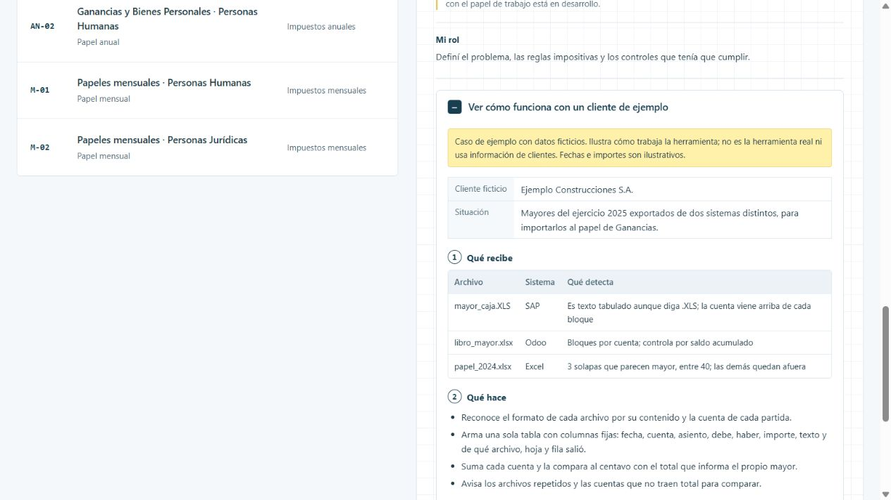

# Estandarizador de mayores

Cada sistema contable exporta el mayor con un formato distinto, y pasarlo al papel de trabajo a mano es lento y riesgoso. El estandarizador lo lleva a una tabla única y controla cada cuenta contra el total del propio mayor.

[Ver la ficha y el caso en el portfolio](https://martinisanchez7.github.io/#estandarizador-mayores/ejemplo) · [Volver al índice](../../README.md)

## Qué recibe

Mayores exportados de SAP (en texto o en Excel), libros mayores de Odoo, listados con saldo y papeles de trabajo con mayores pegados.

## Qué hace

Reconoce el formato por el contenido, no por la extensión del archivo. Identifica la cuenta de cada partida con las mismas reglas que usa el papel de Ganancias, arma una tabla con columnas fijas y controla cuenta por cuenta que lo leído cuadre al centavo con el total del mayor; si se pide, también contra el balance. Lee archivos muy grandes de a partes y borra todo al terminar.

## Qué devuelve

Mayor estandarizado en Excel y en CSV, listo para importar al papel, y un libro de controles con el cuadre de cada cuenta.

## Estado y alcance

En prueba. Probado con más de un millón y medio de partidas. Corre solo en la computadora local; la conexión directa con el papel de trabajo está en desarrollo.

## Mi rol

Definí el problema, las reglas impositivas y los controles que tenía que cumplir.

## Tecnologías

Node.js · JavaScript · ExcelJS · SheetJS

## Caso de ejemplo

Caso de ejemplo con datos ficticios. Ilustra cómo trabaja la herramienta; no es la herramienta real ni usa información de clientes. Fechas e importes son ilustrativos.

**Ejemplo Construcciones S.A..** Mayores del ejercicio 2025 exportados de dos sistemas distintos, para importarlos al papel de Ganancias.

### Qué recibe

| Archivo | Sistema | Qué detecta |
| --- | --- | --- |
| mayor_caja.XLS | SAP | Es texto tabulado aunque diga .XLS; la cuenta viene arriba de cada bloque |
| libro_mayor.xlsx | Odoo | Bloques por cuenta; controla por saldo acumulado |
| papel_2024.xlsx | Excel | 3 solapas que parecen mayor, entre 40; las demás quedan afuera |

### Qué hace

- Reconoce el formato de cada archivo por su contenido y la cuenta de cada partida.
- Arma una sola tabla con columnas fijas: fecha, cuenta, asiento, debe, haber, importe, texto y de qué archivo, hoja y fila salió.
- Suma cada cuenta y la compara al centavo con el total que informa el propio mayor.
- Avisa los archivos repetidos y las cuentas que no traen total para comparar.

### Qué devuelve: controles por cuenta

| Cuenta | Partidas | Total leído | Total del mayor | Control |
| --- | --- | --- | --- | --- |
| 1.1.01 Caja y bancos | 1.240 | $ 1.500.000,00 | $ 1.500.000,00 | Cuadra |
| 2.1.01 Proveedores | 860 | $ -1.800.000,00 | $ -1.800.000,00 | Cuadra |
| 5.2.03 Gastos bancarios | 112 | $ 45.300,00 | $ 45.350,00 | Diferencia $ -50,00 |
| 4.1.01 Ventas | 300 | $ -9.000.000,00 | — | Sin total para comparar |

La tabla estándar sale en Excel y en CSV, lista para importar al papel. La diferencia de $ 50,00 se revisa antes de usarla.

## Captura del caso

