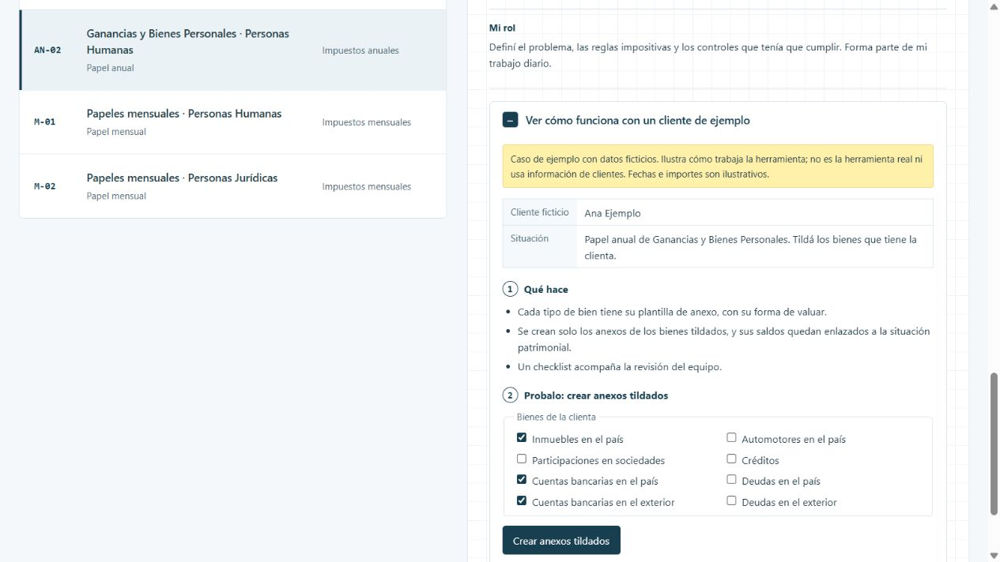

# Ganancias y Bienes Personales · Personas Humanas

Cada cliente tiene bienes, cuentas y deudas distintos, y armar a mano los anexos patrimoniales del país y del exterior consume buena parte de la liquidación.

[Ver la ficha y el caso en el portfolio](https://martinisanchez7.github.io/#ganancias-bp-personas-humanas/ejemplo) · [Volver al índice](../../README.md)

## Qué recibe

Saldos iniciales del año anterior, renta financiera, comprobantes recibidos, pagos a cuenta y tipos de cambio.

## Qué hace

Una cinta propia en Excel crea solo los anexos que el cliente necesita, enlaza sus saldos e importa la información del período. Protege las fórmulas y suma un checklist de revisión para el equipo.

## Qué devuelve

Papel anual de Ganancias y Bienes Personales con anexos enlazados, resumen y checklist.

## Estado y alcance

En uso. Trabaja sobre la plantilla del estudio. No la reemplaza.

## Mi rol

Definí el problema, las reglas impositivas y los controles que tenía que cumplir. Forma parte de mi trabajo diario.

## Tecnologías

Excel · VBA

## Caso de ejemplo

Caso de ejemplo con datos ficticios. Ilustra cómo trabaja la herramienta; no es la herramienta real ni usa información de clientes. Fechas e importes son ilustrativos.

**Ana Ejemplo.** Papel anual de Ganancias y Bienes Personales. Tildá los bienes que tiene la clienta.

### Qué hace

- Cada tipo de bien tiene su plantilla de anexo, con su forma de valuar.
- Se crean solo los anexos de los bienes tildados, y sus saldos quedan enlazados a la situación patrimonial.
- Un checklist acompaña la revisión del equipo.

### Probalo: crear anexos tildados

[Abrir la demostración interactiva](https://martinisanchez7.github.io/#ganancias-bp-personas-humanas/ejemplo).

## Captura del caso

