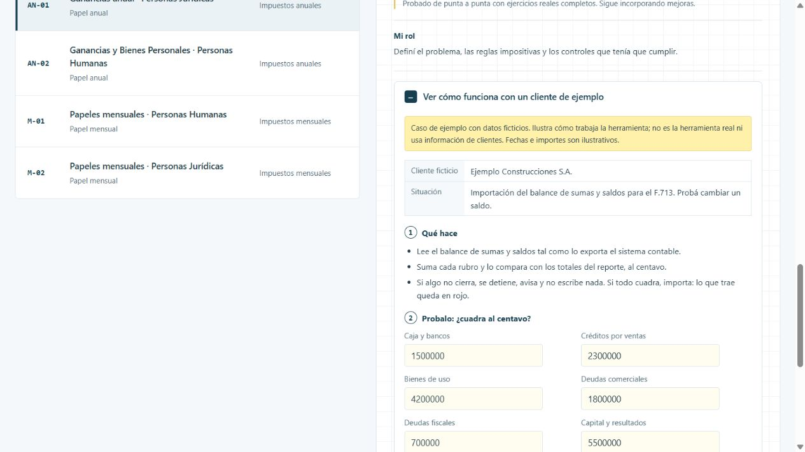

# Ganancias anual · Personas Jurídicas

La DDJJ de Ganancias de una sociedad exige pasar el balance, los mayores y el año anterior a un papel de trabajo extenso. Un error de copiado puede pasar inadvertido hasta la revisión.

[Ver la ficha y el caso en el portfolio](https://martinisanchez7.github.io/#ganancias-personas-juridicas/ejemplo) · [Volver al índice](../../README.md)

## Qué recibe

Sumas y saldos del sistema contable, mayores, papel del año anterior, estados contables y tipos de cambio.

## Qué hace

Importa sumas y saldos y solo escribe si todo cuadra al centavo: si algo no cierra, se detiene y avisa. Arma los anexos y los mayores de cada ajuste. Corrige fórmulas de la plantilla con registro de cada cambio. Lo que trae la herramienta queda en rojo y lo cargado a mano en amarillo.

## Qué devuelve

Papel del F.713 con anexos, controles y trazabilidad, listo para la revisión profesional.

## Estado y alcance

En prueba. Probado de punta a punta con ejercicios reales completos. Sigue incorporando mejoras.

## Mi rol

Definí el problema, las reglas impositivas y los controles que tenía que cumplir.

## Tecnologías

Excel · VBA · PowerShell

## Caso de ejemplo

Caso de ejemplo con datos ficticios. Ilustra cómo trabaja la herramienta; no es la herramienta real ni usa información de clientes. Fechas e importes son ilustrativos.

**Ejemplo Construcciones S.A..** Importación del balance de sumas y saldos para el F.713. Probá cambiar un saldo.

### Qué hace

- Lee el balance de sumas y saldos tal como lo exporta el sistema contable.
- Suma cada rubro y lo compara con los totales del reporte, al centavo.
- Si algo no cierra, se detiene, avisa y no escribe nada. Si todo cuadra, importa: lo que trae queda en rojo.

### Probalo: ¿cuadra al centavo?

[Abrir la demostración interactiva](https://martinisanchez7.github.io/#ganancias-personas-juridicas/ejemplo).

Cambiá cualquier saldo y mirá cómo reacciona antes de escribir en el papel.

## Captura del caso

