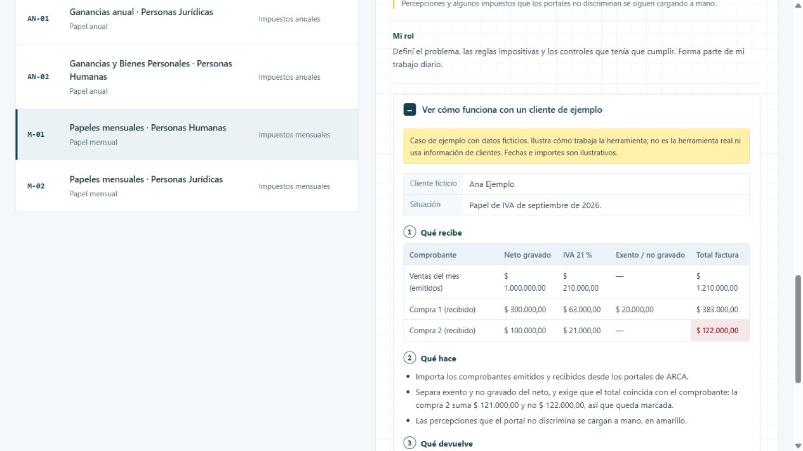

# Papeles mensuales · Personas Humanas

Todos los meses se repite la misma carga de comprobantes, retenciones y percepciones para varios impuestos y clientes. Hecha a mano, es lenta y propensa a errores.

[Ver la ficha y el caso en el portfolio](https://martinisanchez7.github.io/#papeles-mensuales-personas-humanas/ejemplo) · [Volver al índice](../../README.md)

## Qué recibe

Comprobantes emitidos y recibidos, retenciones y percepciones, pagos a cuenta y la DDJJ del mes anterior.

## Qué hace

Importadores desde los portales de ARCA, controles que exigen que cada total coincida con el comprobante y apertura del período siguiente. En SICORE prepara la salida para importar, condicionada a los controles. Un checklist de revisión acompaña cada papel.

## Qué devuelve

Papeles mensuales de IVA, CM03 y SICORE con detalle, controles y checklist.

## Estado y alcance

En uso. Percepciones y algunos impuestos que los portales no discriminan se siguen cargando a mano.

## Mi rol

Definí el problema, las reglas impositivas y los controles que tenía que cumplir. Forma parte de mi trabajo diario.

## Tecnologías

Excel · VBA · Python

## Caso de ejemplo

Caso de ejemplo con datos ficticios. Ilustra cómo trabaja la herramienta; no es la herramienta real ni usa información de clientes. Fechas e importes son ilustrativos.

**Ana Ejemplo.** Papel de IVA de septiembre de 2026.

### Qué recibe

| Comprobante | Neto gravado | IVA 21 % | Exento / no gravado | Total factura |
| --- | --- | --- | --- | --- |
| Ventas del mes (emitidos) | $ 1.000.000,00 | $ 210.000,00 | — | $ 1.210.000,00 |
| Compra 1 (recibido) | $ 300.000,00 | $ 63.000,00 | $ 20.000,00 | $ 383.000,00 |
| Compra 2 (recibido) | $ 100.000,00 | $ 21.000,00 | — | $ 122.000,00 |

### Qué hace

- Importa los comprobantes emitidos y recibidos desde los portales de ARCA.
- Separa exento y no gravado del neto, y exige que el total coincida con el comprobante: la compra 2 suma $ 121.000,00 y no $ 122.000,00, así que queda marcada.
- Las percepciones que el portal no discrimina se cargan a mano, en amarillo.

### Qué devuelve

| Concepto | Importe | Origen |
| --- | --- | --- |
| Débito fiscal | $ 210.000,00 | Importado |
| Crédito fiscal | $ 84.000,00 | Importado |
| Percepciones de IVA | $ 5.000,00 | Carga manual |
| Saldo a pagar | $ 121.000,00 | Calculado |
| Diferencia a revisar | Compra 2: $ 1.000,00 | Antes de presentar |

## Captura del caso

