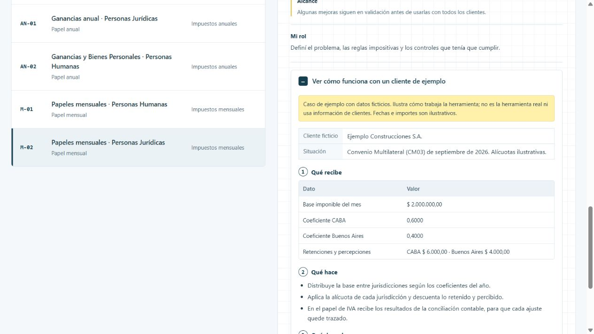

# Papeles mensuales · Personas Jurídicas

En las sociedades, cada papel mensual tiene que coincidir además con la contabilidad. Reunir y controlar esa información en varios impuestos lleva horas todos los meses.

[Ver la ficha y el caso en el portfolio](https://martinisanchez7.github.io/#papeles-mensuales-personas-juridicas/ejemplo) · [Volver al índice](../../README.md)

## Qué recibe

Comprobantes, información contable, coeficientes por jurisdicción, retenciones y percepciones.

## Qué hace

Papeles de IVA, CM03 y SICORE con importación por perfiles y controles. El de IVA recibe los resultados de ConcIVAbot para dejar trazado cada ajuste contable. En SICORE, cada perfil de salida se valida antes de generar el archivo.

## Qué devuelve

Papeles mensuales de sociedades con distribución por jurisdicción, controles y trazabilidad contable.

## Estado y alcance

En prueba. Algunas mejoras siguen en validación antes de usarlas con todos los clientes.

## Mi rol

Definí el problema, las reglas impositivas y los controles que tenía que cumplir.

## Tecnologías

Excel · VBA

## Caso de ejemplo

Caso de ejemplo con datos ficticios. Ilustra cómo trabaja la herramienta; no es la herramienta real ni usa información de clientes. Fechas e importes son ilustrativos.

**Ejemplo Construcciones S.A..** Convenio Multilateral (CM03) de septiembre de 2026. Alícuotas ilustrativas.

### Qué recibe

| Dato | Valor |
| --- | --- |
| Base imponible del mes | $ 2.000.000,00 |
| Coeficiente CABA | 0,6000 |
| Coeficiente Buenos Aires | 0,4000 |
| Retenciones y percepciones | CABA $ 6.000,00 · Buenos Aires $ 4.000,00 |

### Qué hace

- Distribuye la base entre jurisdicciones según los coeficientes del año.
- Aplica la alícuota de cada jurisdicción y descuenta lo retenido y percibido.
- En el papel de IVA recibe los resultados de la conciliación contable, para que cada ajuste quede trazado.

### Qué devuelve

| Jurisdicción | Base asignada | Alícuota | Impuesto | A pagar |
| --- | --- | --- | --- | --- |
| CABA | $ 1.200.000,00 | 3,00 % | $ 36.000,00 | $ 30.000,00 |
| Buenos Aires | $ 800.000,00 | 3,50 % | $ 28.000,00 | $ 24.000,00 |
| Total | $ 2.000.000,00 | — | $ 64.000,00 | $ 54.000,00 |

## Captura del caso

