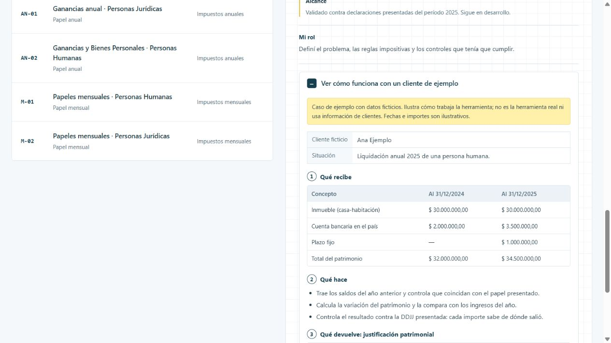

# Papelito

El papel anual en Excel es enorme, frágil y difícil de compartir entre dos personas. Papelito lleva la liquidación a un motor propio, con controles automáticos y datos cifrados.

[Ver la ficha y el caso en el portfolio](https://martinisanchez7.github.io/#papelito/ejemplo) · [Volver al índice](../../README.md)

## Qué recibe

Papel del año anterior, información patrimonial, rentas financieras, la DDJJ presentada y las tablas de valuación de ARCA.

## Qué hace

Calcula el impuesto de Ganancias (escala, quebrantos, deducciones) y el de Bienes Personales. Arma la justificación patrimonial. Controla el papel contra el ejercicio anterior y contra la DDJJ presentada. Cada importe sabe de dónde salió. Guarda la información cifrada y con respaldos verificados.

## Qué devuelve

Papel de trabajo completo, exportable a Excel y PDF para el legajo, con sus controles.

## Estado y alcance

En prueba. Validado contra declaraciones presentadas del período 2025. Sigue en desarrollo.

## Mi rol

Definí el problema, las reglas impositivas y los controles que tenía que cumplir.

## Tecnologías

Python · FastAPI · SQLite · HTML

## Caso de ejemplo

Caso de ejemplo con datos ficticios. Ilustra cómo trabaja la herramienta; no es la herramienta real ni usa información de clientes. Fechas e importes son ilustrativos.

**Ana Ejemplo.** Liquidación anual 2025 de una persona humana.

### Qué recibe

| Concepto | Al 31/12/2024 | Al 31/12/2025 |
| --- | --- | --- |
| Inmueble (casa-habitación) | $ 30.000.000,00 | $ 30.000.000,00 |
| Cuenta bancaria en el país | $ 2.000.000,00 | $ 3.500.000,00 |
| Plazo fijo | — | $ 1.000.000,00 |
| Total del patrimonio | $ 32.000.000,00 | $ 34.500.000,00 |

### Qué hace

- Trae los saldos del año anterior y controla que coincidan con el papel presentado.
- Calcula la variación del patrimonio y la compara con los ingresos del año.
- Controla el resultado contra la DDJJ presentada: cada importe sabe de dónde salió.

### Qué devuelve: justificación patrimonial

| Concepto | Importe | Control |
| --- | --- | --- |
| Variación del patrimonio | $ 2.500.000,00 | Calculado |
| Ingresos netos del año | $ 9.000.000,00 | Calculado |
| Consumo del año (ingresos − variación) | $ 6.500.000,00 | Razonable |
| Diferencia contra la DDJJ presentada | $ 0,00 | Coincide |

Si el consumo diera negativo, el papel lo marca: el patrimonio creció más que los ingresos declarados.

## Captura del caso

