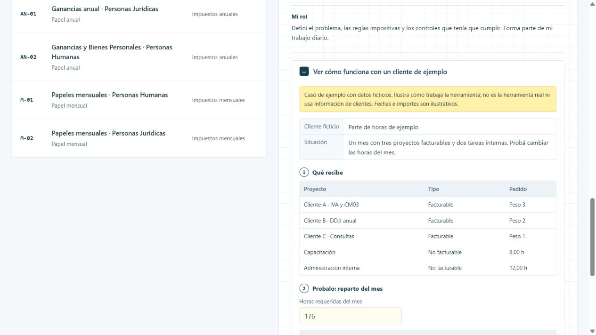

# SigeSpeed

Repartir las horas del mes entre proyectos para que la suma cierre exacta y se cumpla la meta de horas facturables es un rompecabezas mensual, y después hay que cargarlo línea por línea.

[Ver la ficha y el caso en el portfolio](https://martinisanchez7.github.io/#sigespeed/ejemplo) · [Volver al índice](../../README.md)

## Qué recibe

Horas requeridas del mes, feriados, proyectos y actividades habituales.

## Qué hace

Propone el reparto de horas en cuartos de hora, con el cierre exacto y la meta de cargabilidad del 80 %, redondeando siempre para el lado seguro. Muestra las opciones de ajuste y avisa si algo no cierra. Una extensión de Chrome ayuda a completar la grilla, y guardar sigue siendo una acción de la persona.

## Qué devuelve

Parte de horas listo para cargar, con controles de totales y cargabilidad.

## Estado y alcance

En uso. Corre en una computadora local, para una persona.

## Mi rol

Definí el problema, las reglas impositivas y los controles que tenía que cumplir. Forma parte de mi trabajo diario.

## Tecnologías

Next.js · TypeScript · React · Prisma · SQLite · Extensión de Chrome

## Caso de ejemplo

Caso de ejemplo con datos ficticios. Ilustra cómo trabaja la herramienta; no es la herramienta real ni usa información de clientes. Fechas e importes son ilustrativos.

**Parte de horas de ejemplo.** Un mes con tres proyectos facturables y dos tareas internas. Probá cambiar las horas del mes.

### Qué recibe

| Proyecto | Tipo | Pedido |
| --- | --- | --- |
| Cliente A · IVA y CM03 | Facturable | Peso 3 |
| Cliente B · DDJJ anual | Facturable | Peso 2 |
| Cliente C · Consultas | Facturable | Peso 1 |
| Capacitación | No facturable | 8,00 h |
| Administración interna | No facturable | 12,00 h |

### Probalo: reparto del mes

[Abrir la demostración interactiva](https://martinisanchez7.github.io/#sigespeed/ejemplo).

Las horas facturables tienen que llegar al 80 % y el total cerrar exacto, en cuartos de hora. El redondeo va siempre para el lado seguro.

## Captura del caso

